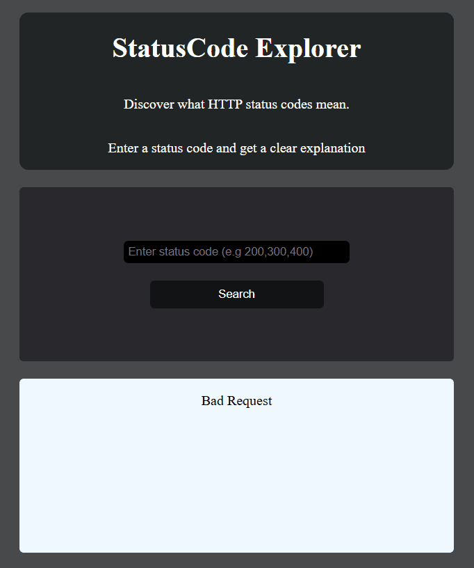
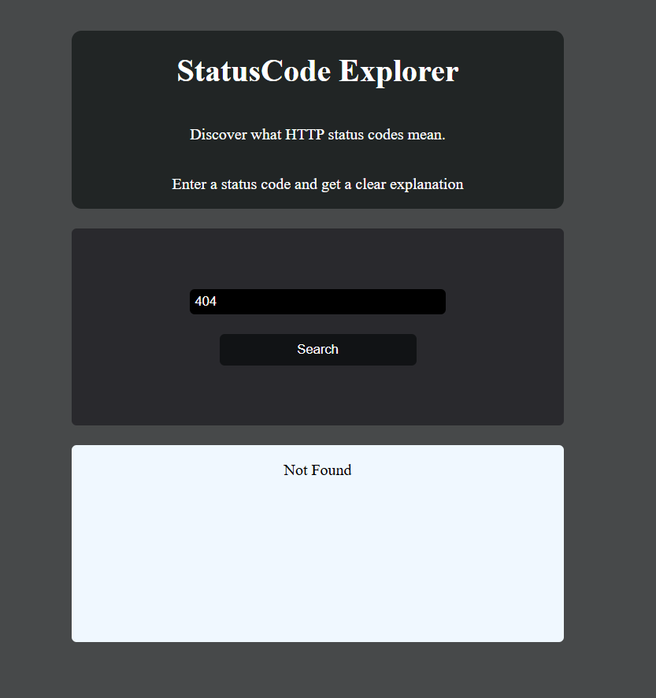

# Status Code Explorer!!! 
Hey this is for understand the what status code means in backend in simple.
here's an AWESOME gif of my project!

## HOW THIS WAS MADE
I made this because i frequently forget the status code meanining.so i build this to see instantly.
## What does it do
it will tell the status code meaning in backend in short.it will instantly help to remember the status code meaning in simple.
## Tech stack
1.Node js
2.Express js
3.Javascript
4.HTML
5.CSS
## Demo Link
[Here is live demo of my project](https://status-code-explorer-git-main-dr-sauravs-projects.vercel.app/index.html)
## Screenshots

## Problem i faced
i face little problem while deploying it in vercel like before i have setup everything locally so it was working well in localhost but it not work well in the vercel when i deploy and i have to fix things like changing the url while fetching and i have to redirect it to index.html when visiting in / route.
### Development
1. Clone the source code to your device
```sh
git clone https://github.com/Saurav-Khanal/Status-Code-Explorer.git
```
2. Install the project's dependencies
```sh
npm install
```

3. Start the development server on `localhost:3000`
```sh
node server.js
```
4. Open the project in your browser
```sh
http://localhost:3000
```

## AI DISCLOSURE
I used ai for generating the status code array and for some debug only.